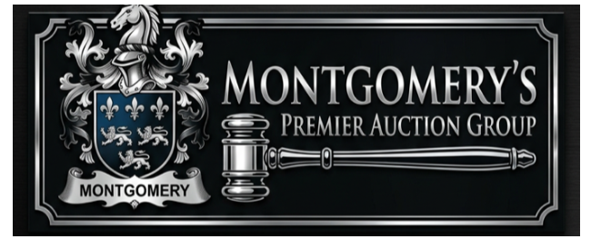

# Montgomery's Premier Auction Group

A luxury, full-featured web platform and live auction bidding console built for **John Montgomery** and **Montgomery's Premier Auction Group**.



---

## 🏛️ About Montgomery Premier

With over 25 years of industry leadership, Founder & Principal Auctioneer **John Montgomery** specializes in high-stakes commercial real estate, heavy construction equipment, agricultural machinery, and commercial fleet liquidations. His unwavering commitment to transparency and excellence serves as the cornerstone of Montgomery Premier.

* **Principal Auctioneer:** John Montgomery
* **Direct Inquiries:** `john.montgomery@montgomeryauctiongroup.com`
* **Auction Arena & Yard HQ:** Lexington, Kentucky

---

## 🚀 Key Features

### 1. 📂 Comprehensive Lot Catalog & Search Engine
* **Real-time Directory:** Instant search by keyword, equipment model, or lot number.
* **Granular Filtering:** Filter by asset category (*Heavy Equipment*, *Farm Equipment*, *On & Off-Road Vehicles*, *Real Estate*, *Tools*), condition (*Like New*, *Excellent*, *Good*, *Turnkey*), and price range.
* **Display Modes:** Seamless switcher between responsive Card Grid and High-Density Table List views.
* **Certified Inspection Records:** Verification badges, operating hours, machine serial numbers, and fluid analysis records.

### 2. 📅 Upcoming Auctions & Interactive Calendar
* **Dual Viewing Experience:** Toggle between an interactive monthly calendar schedule and a detailed auction list view.
* **One-Click Calendar Sync:** Direct integration with **Google Calendar** and downloadable **RFC 5545 `.ics` iCal** files for Apple Calendar and Microsoft Outlook.
* **Multi-Channel Sharing:** Instant social sharing across LinkedIn, Facebook, X (Twitter), Email, and direct clipboard link copying.

### 3. 🚜 Buy Now Sales (Immediate Liquidation Program)
* Built specifically for high-value equipment consignors seeking rapid liquidation without waiting for scheduled auction days.
* Complete specifications for heavy excavators, high-horsepower tractors, utility rigs, and commercial service trucks.
* **Instant Checkout & Order Reservation:** Generate official Bills of Sale with wire/escrow settlement instructions.
* **Counter-Offer Negotiation:** Formal "Make an Offer" proposal workflow directly submitted to John Montgomery.

### 4. 🔴 Live Simulcast Auction Room
* **Live Video Streaming:** Live broadcast player embeddable with any YouTube Live, Vimeo, or external RTMP/OBS stream.
* **Real-time Live Bidding Console:** Quick increment bids (`+$1,000`, `+$2,500`, `+$5,000`, `+$10,000`) and custom bids.
* **Live Bid Ledger:** Real-time ledger tracking floor bidders, phone bids, and online bids.
* **Countdown Fair Warning System:** Timed countdown with automatic warning audio alerts.
* **Synthesized Audio Suite (Web Audio API):** Zero-dependency offline audio generator for gavel knocks and alert chimes.
* **Clerk Feed:** Live interactive room chat between bidders and Montgomery auction staff.

### 5. 👤 Customer Profiles & Bidder Dashboard
* Customer self-registration and authentication.
* Auto-generated verified Bidder Numbers (e.g. `#MP-4082`).
* Pre-approved bidding credit limits ($500,000 default).
* User dashboard tracking active bids (Winning vs. Outbid), saved watchlists, and settled bills of sale.

### 6. 🛠️ Client Management Portal (Admin Mode)
* Dedicated client portal allowing John Montgomery to manage the platform in real time:
  * **Add, edit, or archive Catalog lots.**
  * **Schedule new Upcoming Auctions and configure calendar details.**
  * **List new Buy Now liquidation inventory.**
  * **Control the Live Simulcast Room:** Switch the active lot on the podium, change stream URLs, and trigger manual gavel strikes.
  * Local persistence via browser storage.

---

## 💻 Tech Stack

* **Framework:** [React 19](https://react.dev/) + [Vite](https://vitejs.dev/)
* **Styling:** [Tailwind CSS](https://tailwindcss.com/) (Custom luxury dark theme with warm gold gradients)
* **Icons:** [Lucide React](https://lucide.dev/)
* **Typography:** Cinzel (Editorial Luxury Serif) & Inter (Modern Sans)
* **Audio:** Native Web Audio API (Synthesized gavel & bell tones)

---

## 🛠️ Getting Started

### Prerequisites
* [Node.js](https://nodejs.org/) (v18 or higher recommended)
* `npm` or `yarn`

### Installation

1. **Clone the repository:**
   ```bash
   git clone https://github.com/nedmorris-sys/Montgomery-Auctions.git
   cd Montgomery-Auctions
   ```

2. **Install dependencies:**
   ```bash
   npm install
   ```

3. **Start the local development server:**
   ```bash
   npm run dev
   ```
   Open [http://localhost:3000](http://localhost:3000) in your browser.

4. **Build for production:**
   ```bash
   npm run build
   ```
   The production-ready output will be located in the `dist/` directory.

---

## 📄 License
Private & Proprietary — Developed for **Montgomery's Premier Auction Group**.
